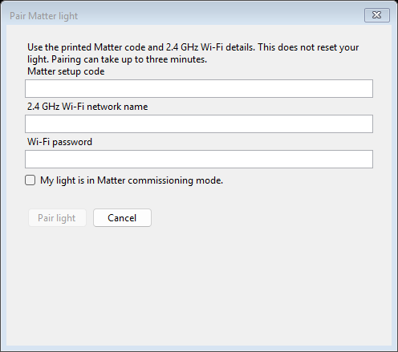
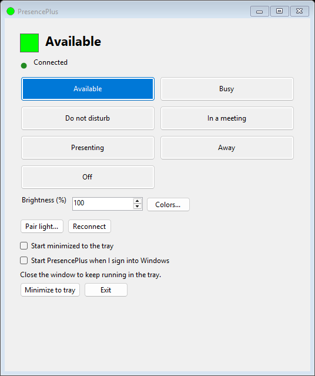
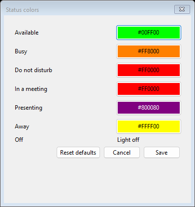

# PresencePlus

A Windows tray app that controls a Matter color light directly over your local
network. Choose your status in the window or tray menu. No Microsoft 365 access,
Azure hosting, Google Home, Home Assistant, Cync API, LED URL, API key, web server,
or public tunnel is required.

The WinForms app owns one local Matter.js helper process, communicating through
private standard-input/output pipes. Bluetooth is used for initial commissioning;
normal control and reconnect use the light's local Wi-Fi/IPv6 connection.

## Download and run

Download the **PresencePlus-...-win-x64.zip** asset from the
[GitHub Releases](https://github.com/duanekord/PresencePlus/releases),
not GitHub's automatic **Source code** ZIP.
Early downloads may be marked **Pre-release** while the pull request is awaiting
approval; these are previews, not a claim that the changes are already on `main`.

1. Extract the entire ZIP into a permanent folder you can write to, such as
   `%LOCALAPPDATA%\PresencePlus\app`.
2. Run **PresencePlus.exe** from that folder. Keep the `Matter` folder and all DLLs
   beside it; the executable is not a standalone single file.
3. Follow the pairing walkthrough below, then choose a status.

The portable download includes **.NET and Node.js**. You do not need an SDK,
PowerShell, a global Node installation, Azure resources, or an account to run it.
No administrator installation or Windows service is required.

**Requirements:** Windows x64 (Windows 11 recommended), a supported Matter-over-Wi-Fi
color light, Bluetooth for first-time setup, and a local network with IPv6 and
multicast discovery. Have the light's Matter setup code and compatible Wi-Fi
credentials ready. Many lights, including the tested Cync strip, require 2.4 GHz
Wi-Fi. Internet access is needed during pairing for certificate verification.

This is an early release: tested hardware is a **GE Cync Indoor Light Strip 32ft**
(`CSTR32CBDM/MSS-1P`). Other hue/saturation-capable Matter-over-Wi-Fi lights may work
but are not yet verified. Thread commissioning, multiple lights, and automatic
Teams presence are not supported. Linux, macOS, and ARM64 packages are not provided.

Release archives have a companion `.sha256` file. To compare a download:

```powershell
Get-FileHash .\PresencePlus-0.1.0-win-x64.zip -Algorithm SHA256
```

Use the actual versioned filename you downloaded and compare the result with the
hash in its matching `.sha256` asset. A checksum checks
integrity, not publisher identity. Builds are currently **unsigned**; Windows may
show publisher/reputation warnings. Review the source, release origin, and your
organization's software policy before deciding whether to run the app.

## Connect your light: quick walkthrough

1. **Prepare the light.** Power it on, enable the PC's Bluetooth, and follow the
   manufacturer's instructions to enter **Matter commissioning mode**. Ordinary
   Bluetooth visibility is not enough. If the light is already commissioned,
   follow the manufacturer's instructions to open another pairing window or reset
   it. A factory reset removes existing pairings and routines; PresencePlus never
   resets the light automatically.
2. **Choose Pair light...** Enter the printed **Matter setup code**, the light's
   **Wi-Fi network name (SSID)**, and the **Wi-Fi password**. Confirm that the light
   is in commissioning mode and select **Pair light**. Keep it powered and nearby;
   setup can take up to three minutes. Enter credentials only in this local
   dialog, never in GitHub issues, chat, shell arguments, or logs.



3. **Wait for Connected.** Bluetooth securely commissions the light and provisions
   its Wi-Fi connection. Subsequent control uses the local network, not Bluetooth,
   Google Home, or Cync's cloud. The app saves its controller identity, so pairing
   is not repeated on Windows login or app restart. Keep the PC and light on the
   same reachable LAN; a guest network with client isolation will prevent control.
4. **Choose a status.** Use a window button or the notification-area menu. The
   small green connection indicator means the light acknowledged the selection.
   Hover over it for details if it says **Retrying**, or choose **Reconnect**.
   **Off** sends a real power-off command.



5. **Make it yours.** Use **Colors...** to choose each status's color and **Save**
   to apply it. Adjust brightness as needed. Optionally select **Start PresencePlus
   when I sign into Windows**. Closing the window keeps the app in the tray;
   **Exit** stops it.



Screenshots are rendered from the actual Windows forms with simulated output and
empty credential fields; they contain no real Wi-Fi details or pairing secrets.
This version supports **one paired light endpoint**. Pairing again does not
silently replace it. Do not copy controller identities between PCs or run the
experiment and tray app against copies of the same identity simultaneously.

## Technologies and architecture

| Component | Technology and role |
|---|---|
| Desktop app | C# / .NET 10, Windows Forms, native tray menu and color picker |
| Local controller | TypeScript, Matter.js 0.18.0, bundled Node.js 24.22.2 |
| Initial setup | Native Windows Bluetooth LE through `@matter/nodejs-ble`; production Matter device attestation |
| Normal control | Matter over the local Wi-Fi/IPv6 network, with multicast discovery |
| App/helper communication | Private JSON-lines standard-input/output pipes; no app HTTP listener |
| Preferences and pairing | Per-user JSON preferences and a separately permission-restricted Matter fabric store |
| Distribution | Self-contained Windows x64 ZIP, SHA256 checksum, GitHub Actions and GitHub Releases |

No Graph permissions, Entra app registration, cloud hosting, Google Home, or Cync
API is required. Internet access for production attestation is distinct from a
cloud-based light-control service.

## Troubleshooting

| Symptom | What to check |
|---|---|
| Not paired | Choose **Pair light...** and complete commissioning once. |
| No device found during pairing | Confirm **Matter** pairing mode, PC Bluetooth, proximity, setup code, and that the commissioning window has not expired. |
| Wi-Fi setup fails | Check SSID/password and the light's supported band, commonly 2.4 GHz. |
| Retrying / reconnect timeout | Check power, PC/light LAN reachability, IPv6, multicast, guest isolation, VPNs, and relevant network policy. Hover for details; **Reconnect** retries immediately. |
| Attestation fails | Ensure internet access to CSA's production certificate service. Verification is intentionally not bypassed. |
| Runtime missing / app will not start | Extract the whole release ZIP, not just the executable or the source ZIP. Keep all files together. |
| Already running | Open the existing instance from the notification area, including hidden tray icons. |
| Preferences cannot load | Review the startup error and `%LOCALAPPDATA%\PresencePlus\settings.json`; invalid values are surfaced instead of silently discarded. |
| Paired light still on after Exit | Expected: Exit stops control, not the light. Choose **Off** and wait for **Connected** first. |

### Preserve a pairing from the local experiment

Exit PresencePlus and stop the experimental controller before importing:

```powershell
.\scripts\Import-MatterPairing.ps1 -SourceDirectory 'C:\path\to\experiment\hardware-storage'
```

The importer preserves the original controller namespace and fabric credentials,
restricts the destination to your Windows account, and refuses to overwrite an
existing destination. It leaves the original source intact. No reset or new
setup code is needed for an imported working pairing.

## Status, colors, and brightness

| Status | Default color |
|---|---|
| Available | Green |
| Busy | Orange |
| Do not disturb | Red |
| In a meeting | Red |
| Presenting | Purple |
| Away | Yellow |
| Off | Actual Matter power-off command |

Choose **Colors...** to customize each lit status with the Windows color picker.
**Save** applies the palette; **Cancel** discards edits, and **Reset defaults**
restores the original colors when saved. Changing the active status's color
updates the light immediately. **Off** is always power-off, not an editable color.

These are manual choices, not detected Teams presence. All colors are solid.
The brightness setting scales the palette's RGB intensity; purple retains its
lower original intensity. Colors and brightness are applied before power-on to
avoid flashing the previous color. The tray icon reflects your selection; the
window uses a small connection dot and a short label. Green **Connected** means
the selection was acknowledged; amber indicates connecting, updating, or retrying.
Hover over the indicator for details, including actionable connection errors.
The same details are available to accessibility tools.

Without a pairing, status selection remains a preview and the indicator shows
**Not paired**; choose **Pair light...**. Changes are serialized, and the latest selection follows an
in-flight command. Failures are shown and retried after a short delay, without
blocking the UI. **Reconnect** retries immediately.

The app also reapplies the current selection every 30 seconds to detect and
recover from light restarts or lost state. A restarted helper triggers an
immediate reapply. This app therefore owns the light's selected color while it
is running; another controller's changes can be overwritten.

Minimizing or closing the window keeps the app in the tray. Double-click the
icon or choose **Open PresencePlus** to restore it. Choose **Exit** to stop both
the app and its helper. Only one app instance per Windows user can run.

Exiting, PC sleep, logout, and network loss do **not** automatically turn off the
hardware. Choose **Off** and wait for **Connected** before exiting if
needed. Use a device-side watchdog if automatic fail-safe behavior is required.

## Settings and security

Preferences are saved atomically to
`%LOCALAPPDATA%\PresencePlus\settings.json`. Your palette, last status, and brightness are
restored and sent on startup. Invalid settings produce a visible error rather
than silently resetting your choices.

Matter controller credentials are stored separately under
`%LOCALAPPDATA%\PresencePlus\Matter`, with current-user-only Windows permissions.
Protect this directory as a secret: deleting it loses the controller identity,
and copying it grants control of the paired light. Permissions are not encrypted
storage and do not protect against software already running as your user.
Keep this directory out of source control, shared logs, and unprotected backups.

Production attestation checks remain enabled. The only permitted finding is the
informational `PaaTrustStoreTimeMismatch`, emitted when a freshly initialized
controller downloads a trusted root after the device certificate was issued.
Certificate errors, warnings, test certificates, unavailable trust services, and
all other findings remain blocked. Raw protocol payloads are not logged.

The helper uses no listener or HTTP port for app communication. Do not expose
Matter services to the public internet. Your network must allow local IPv6 and
multicast discovery between the PC and light. The app scopes discovery to an
active Wi-Fi or Ethernet adapter with a gateway, preferring Wi-Fi, to avoid
Hyper-V/WSL virtual interfaces delaying reconnect. With no suitable adapter,
the Matter stack uses its default interface discovery.

## Start with Windows

Extract or publish to a permanent folder, run `PresencePlus.exe`, and select **Start
PresencePlus when I sign into Windows**. This creates only your own
`HKCU\Software\Microsoft\Windows\CurrentVersion\Run\PresencePlus` entry, pointing
to that executable with `--minimized`. It requires no administrator privileges
or Windows service. Uncheck the option to remove the entry.

The independent **Start minimized to the tray** preference applies to manual
launches too. Disable startup before moving the executable, then re-enable it
from the new location. Remove any older scheduled task to avoid duplicate
launches. Windows or organizational policies can restrict startup.

## Migrating older versions

Stop the old PresencePlus app, Caddy, and any tunnel. Graph/MSAL, webhooks,
automatic meeting detection, and the custom HTTP LED contract are removed.
`Graph__*`, `Led__Url`, `Led__ApiKey`, appsettings files, and `--urls` no longer
configure the app. Old saved `LedUrl` fields are ignored while status and tray
preferences are preserved; the next settings save drops obsolete fields.

To update a portable installation, choose **Exit**, extract the new archive into
the app folder, and run it again. Preferences and pairing are kept outside the app
folder and survive upgrades. Do not delete `%LOCALAPPDATA%\PresencePlus\Matter`
or share it with another person. Extracting a release never imports somebody
else's pairing.

## Build and package from source

Requires Windows x64, PowerShell 7, and the .NET 10 SDK:

```powershell
# Complete runnable app, including .NET and the Matter helper:
.\scripts\Publish.ps1 -OutputDirectory .\artifacts\publish

# Redistributable ZIP and SHA256 file:
.\scripts\Package.ps1 -Version 0.1.0
```

`Publish.ps1` downloads the pinned Node.js distribution from nodejs.org and checks
its SHA256 against the official HTTPS checksum list before extraction. It restores
locked npm dependencies without install scripts, compiles the helper, and bundles
production dependencies. It does not install Node globally or replace Bluetooth
drivers. Supply `-NodeDirectory 'C:\path\to\node-v24.22.2-win-x64'` to reuse a trusted
full Node distribution, including npm.

The default publish is **self-contained** for `win-x64`. Developers can opt into
`-FrameworkDependent` for a smaller app that requires the .NET 10 Desktop Runtime.
A plain `dotnet build` does not package the helper. Packaging always uses a fresh
staging folder, never your installed app or user-data folder; it includes runtime
and dependency license notices, but no personal settings or controller fabric.

GitHub Actions runs checks and creates downloadable workflow artifacts on pull
requests and pushes to `main`. Publishing a version tag from reviewed `main`
also creates the public GitHub release and uploads the ZIP and checksum:

```powershell
git tag v0.1.0
git push origin v0.1.0
```

Use a new semantic version for each release. Do not retag an existing download.
Release publishing uses only the workflow's repository-scoped GitHub token.
Tags with a suffix, such as `v0.1.0-rc.1`, publish a clearly marked pre-release;
normal releases should be tagged from reviewed `main`. Branch protections still
apply: a successful build does not replace a required approving review.

The project has not yet selected an open-source license. Third-party components
retain their own licenses, included in the download's `licenses` directory,
`Matter` package directories, and `THIRD-PARTY-NOTICES.txt`.

## Development checks

```powershell
dotnet run --project .\tests\PresencePlus.Checks
# Include real process/pipe lifecycle checks using a trusted Node executable:
dotnet run --project .\tests\PresencePlus.Checks -- --node 'C:\path\to\node.exe'

# Refresh documentation images from real forms with simulated output:
dotnet run --project .\tests\PresencePlus.Checks -- --screenshots .\docs\screenshots

# From src\PresencePlus.Matter, with the pinned Node distribution on PATH:
npm ci --ignore-scripts --no-fund --no-audit
npm run build
npm test
```

The dependency-free C# executable covers settings migration, status delivery,
color customization, brightness, retries, latest-selection wins, helper restarts, private storage,
tray UI, masking, and optional real IPC cancellation/protocol failures.
Helper checks cover RGB conversion, command ordering, actual power-off semantics,
input validation, credential-safe errors, and fail-closed attestation.

An opt-in hardware check changes the real light through every status and a custom color, then
restores your saved selection. Exit the tray app first:

```powershell
dotnet run --project .\tests\PresencePlus.Checks -- --hardware "$env:LOCALAPPDATA\PresencePlus\app\Matter"
```
